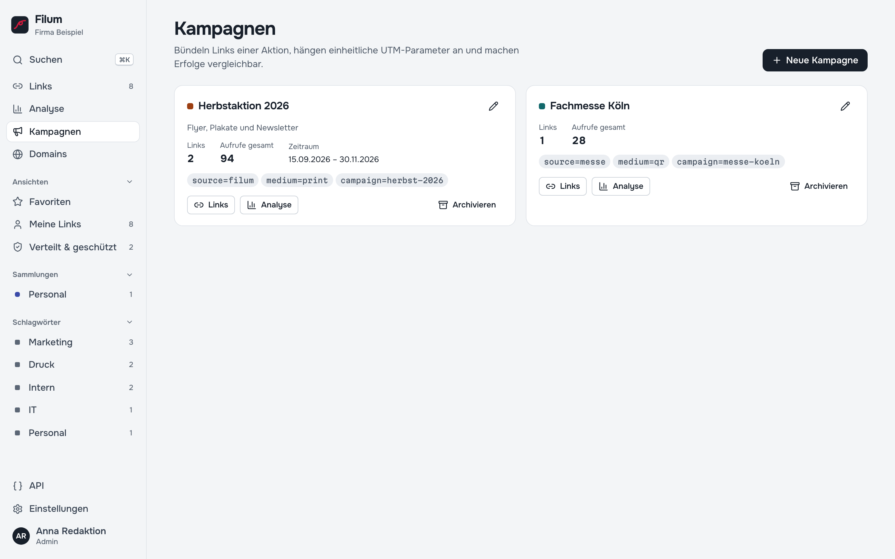

# Filum

[](https://github.com/PBaumfalk/Filum/actions/workflows/ci.yml)
[](LICENSE)
[](https://ghcr.io/pbaumfalk/filum)

**Kurzlinks auf der eigenen Domain, die auch gedruckt verlässlich bleiben, mit ehrlicher Statistik und ohne Cloud.** Filum ist ein kostenloses Link-Management-Studio für Unternehmen, Kanzleien, Vereine und Verwaltungen: Aus `https://www.firma.de/veranstaltungen/2026/sommerfest/anmeldung?formular=4711` wird `go.firma.de/sommerfest`, passend für Flyer, Plakate, QR-Codes, E-Mails und Folien. Zieht die Seite um, ändern Sie in Filum das Ziel, und jeder gedruckte Link führt weiter an die richtige Stelle.

Filum läuft auf **Ihrem eigenen Server**: ohne Abo, ohne Konto bei einem Anbieter, ohne Tracking durch Dritte. Gezählt werden Aufrufe, keine Personen; IP-Adressen und Cookies von Besuchern speichert Filum nicht.

*Filum* ist lateinisch für **Faden**: der Faden zwischen einer kurzen Adresse und ihrem Ziel, der derselbe bleibt, auch wenn sich das Ziel ändert.

> **English abstract** — Self-hosted link management studio: short links on your own domains, campaigns with UTM parameters, schedules, password protection, device/language/time rules, A/B variants, QR codes with scan attribution, import/export, REST API, roles and OIDC login. Privacy-friendly aggregate-only statistics (no IPs, no visitor cookies). Node.js 24, Fastify, SQLite, React; ships as one Docker image (amd64/arm64) with redirects and admin strictly separated on two ports. UI and documentation are in German.


## 📖 Handbuch

Die vollständige Dokumentation, verständlich für alle, die Links anlegen, wie für die IT, steht im **[Handbuch](docs/handbuch/README.md)**: 23 Kapitel mit Bildschirmfotos, vom [Schnelleinstieg](docs/handbuch/README.md#schnelleinstieg-in-5-minuten) über [Links anlegen](docs/handbuch/03-links-anlegen.md), [Zeitplan, Schutz und Regeln](docs/handbuch/05-zeitplan-schutz-regeln.md) und die [Analyse](docs/handbuch/08-analyse.md) bis zu [Installation](docs/handbuch/13-installation.md), [Sicherung](docs/handbuch/17-sicherung.md) und [REST-API](docs/handbuch/19-rest-api.md).

## Installation

Filum ist eine Server-Anwendung: Sie wird einmal installiert, und alle im Team nutzen sie im Browser.

<details>
<summary><strong>🧪 Ausprobieren in einer Minute</strong> (auf dem eigenen Rechner mit Docker Desktop)</summary>

```bash
docker run -d --name filum -p 8080:8080 -p 8081:8081 \
  -e DEFAULT_DOMAIN=localhost:8080 -v filum-data:/data \
  ghcr.io/pbaumfalk/filum:1
docker logs filum        # zeigt den Einrichtungscode
```

Dann <http://localhost:8081> öffnen, Einrichtungscode eingeben, Konto anlegen und den ersten Link kürzen. Die Kurzlinks lauten hier `http://localhost:8080/…`. Wieder entfernen: `docker rm -f filum && docker volume rm filum-data`.
</details>

<details>
<summary><strong>🖥️ Auf einem Server</strong> (für die IT: Docker Compose hinter einem Reverse Proxy)</summary>

```bash
git clone https://github.com/PBaumfalk/Filum.git && cd Filum
cp .env.example .env          # APP_URL und DEFAULT_DOMAIN anpassen (Pflicht)
docker compose up -d --build  # Docker Compose 2.24 oder neuer
docker compose logs filum     # Einrichtungscode ablesen
```

Ohne eigenes Bauen: in `.env` `FILUM_IMAGE=ghcr.io/pbaumfalk/filum:1` setzen und `docker compose up -d` aufrufen. Fertige Images für amd64 und arm64 entstehen bei jedem Release.

Filum trennt Besucher und Verwaltung auf zwei Ports:

| Port | Inhalt | Im Reverse Proxy für |
| --- | --- | --- |
| 8080 | nur Kurzlink-Weiterleitungen | die Kurzlink-Domains, z. B. `go.firma.de` |
| 8081 | Oberfläche und API | die Verwaltungsadresse, z. B. `filum.intranet.firma.de`, nur intern |

Proxy-Beispiele für Caddy, nginx und Traefik, HTTPS, Updates und Sicherung: [Handbuch, Kapitel 13–18](docs/handbuch/13-installation.md).
</details>

## Funktionen im Überblick

| Kampagnen | Analyse |
| --- | --- |
|  |  |

- **Kürzen in zwei Sekunden**: Adresse einfügen, Enter, der Kurzlink liegt in der Zwischenablage. Eigene oder lesbare Kurzadressen, mehrere Adressen auf einmal, Lesezeichen „Mit Filum kürzen“, Hinweis auf vorhandene Links zum selben Ziel — [Kapitel 3](docs/handbuch/03-links-anlegen.md)
- **Gedruckte Links bleiben verlässlich**: Eine einmal vergebene Kurzadresse wird nie für etwas anderes neu vergeben. Links lassen sich als *verteilt* schützen, jede Zieländerung steht im Verlauf und lässt sich zurückholen — [Kapitel 4](docs/handbuch/04-links-verwalten.md)
- **Zeitplan, Limit, Passwort, Regeln**: Aktiv ab und bis, Ersatzziel nach Ablauf, Passwortschutz, andere Ziele je Gerät, Sprache, Uhrzeit oder Wochentag, A/B-Varianten — [Kapitel 5](docs/handbuch/05-zeitplan-schutz-regeln.md)
- **Kampagnen mit UTM-Parametern**, Sammlungen, Schlagwörter und Vorlagen für wiederkehrende Aufgaben — [Kapitel 6](docs/handbuch/06-kampagnen-sammlungen.md)
- **QR-Codes mit Herkunft**: PNG bis 4096 px oder SVG für die Druckerei; Filum zeigt, wie viele Besucher über den Code kamen — [Kapitel 7](docs/handbuch/07-qr-codes.md)
- **Ehrliche Statistik**: Aufrufe statt Personen, Bots und Messenger-Vorschauen getrennt gezählt, Kampagnenvergleich, „Wann wird geklickt“ — [Kapitel 8](docs/handbuch/08-analyse.md)
- **Vertipper-Radar**: zeigt Kurzadressen, die aufgerufen werden, aber nicht existieren, etwa wegen eines Tippfehlers auf dem Flyer, und leitet sie mit einem Klick auf den gemeinten Link — [Kapitel 8](docs/handbuch/08-analyse.md#vertipper-radar)
- **Vorschau für Empfänger**: `go.firma.de/sommerfest+` zeigt das Ziel, bevor jemand klickt, mit Meldemöglichkeit bei Missbrauch — [Kapitel 5](docs/handbuch/05-zeitplan-schutz-regeln.md#vorschau-für-empfänger)
- **Mehrere Domains** mit Besitznachweis und fertigen Proxy-Bausteinen — [Kapitel 9](docs/handbuch/09-domains.md)
- **Team**: vier Rollen von *Ansehen* bis *Admin*, Einladung per Link, Anmeldung über authentik/OIDC, Protokoll aller Änderungen — [Kapitel 10](docs/handbuch/10-team-und-rechte.md)
- **Datenschutz zum Einstellen**: Statistik aus, Grund oder erweitert, Aufbewahrungsfristen und ein fertiger Textbaustein für die Datenschutzerklärung — [Kapitel 12](docs/handbuch/12-datenschutz.md)
- **Für den Betrieb gebaut**: automatische Sicherungen mit Wiederherstellen per Klick, ein Container, schreibgeschütztes Dateisystem, rund 46 000 Weiterleitungen pro Sekunde in einem Prozess ([gemessen](docs/handbuch/18-betrieb.md#ressourcen)) — [Kapitel 17](docs/handbuch/17-sicherung.md) & [18](docs/handbuch/18-betrieb.md)
- **REST-API** mit Tokens und OpenAPI-Beschreibung, z. B. für Newsletter-Systeme — [Kapitel 19](docs/handbuch/19-rest-api.md)
- **Hell & Dunkel**: folgt der Systemeinstellung, umschaltbar im Kontomenü; funktioniert auch auf dem Smartphone — [Kapitel 2](docs/handbuch/02-erste-schritte.md#die-oberfläche)


## Für Entwickler

Filum ist ein einzelner Node-24-Prozess in TypeScript: [Fastify 5](https://fastify.dev) mit zwei getrennten Instanzen für Weiterleitung und Verwaltung, SQLite im WAL-Modus über better-sqlite3 als einzige Datenhaltung, die Oberfläche in React 19 mit eigenem CSS-Designsystem statt einer Komponentenbibliothek. Keine zweite Datenbank, kein Redis, kein externer Dienst. Warum so: [Kapitel 21 — Architektur](docs/handbuch/21-architektur.md).

```bash
npm install
npm run dev:server   # API und Weiterleitung auf 18081/18080 (Daten in ./data)
npm run dev:web      # Oberfläche mit Hot Reload auf 5173
npm test             # rund 300 Server-Tests (vitest)
npm run typecheck
scripts/e2e-local.sh # Browser-Tests gegen frischen Build, Desktop und Smartphone
scripts/docker-lifecycle-test.sh   # Container: Persistenz, Sicherung, Wiederherstellung
npm run docs:check   # Links und Anker in README und Handbuch prüfen
npm run docs:screenshots           # Bildschirmfotos aus einer Beispielinstanz neu erzeugen
```

Für `dev:server` die Ports setzen: `PUBLIC_PORT=18080 ADMIN_PORT=18081 APP_URL=http://localhost:5173 DEFAULT_DOMAIN=localhost:18080`.

Alle drei Testebenen laufen bei jedem Push in GitHub Actions; ein Release-Image entsteht nur, wenn alle grün sind — [Kapitel 22](docs/handbuch/22-tests.md). Was sich von Version zu Version ändert, steht im [Änderungsprotokoll](CHANGELOG.md).

## Lizenz

[MIT](LICENSE) — © 2026 Patrick Baumfalk.

Mit der Oberfläche ausgeliefert werden unter anderem die Schriften [Onest](https://github.com/simpals/onest) und [Martian Mono](https://github.com/evilmartians/mono) (beide SIL Open Font License 1.1) sowie Symbole aus [Lucide](https://lucide.dev) (ISC-Lizenz). Die Lizenzen aller npm-Abhängigkeiten stehen in deren Paketen unter `node_modules/`.

## Hinweis

Filum ist ein Werkzeug; wer es betreibt, ist für die verarbeiteten Daten verantwortlich. Den Textbaustein für die Datenschutzerklärung und die Bewertung in [Kapitel 12](docs/handbuch/12-datenschutz.md) bitte vor der Veröffentlichung prüfen bzw. prüfen lassen. Die Software wird ohne Gewähr bereitgestellt (siehe [LICENSE](LICENSE)).
