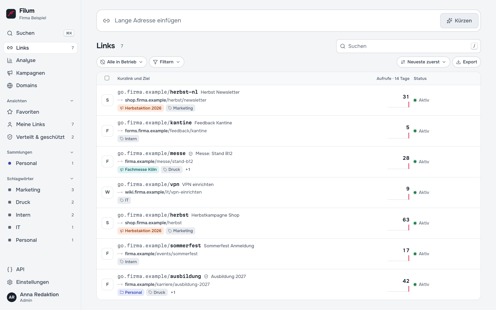

# 1 — Was ist Filum?

Filum macht aus langen Adressen kurze, merkbare Links auf Ihrer eigenen Domain, etwa `go.firma.de/sommerfest` statt `https://www.firma.de/veranstaltungen/2026/sommerfest/anmeldung?formular=4711`. Solche Links passen auf Flyer, Plakate, Visitenkarten, in E-Mails und auf Folien. Filum läuft auf Ihrem eigenen Server: ohne Cloud-Dienst, ohne Abo und ohne Tracking durch Dritte.

*Filum* ist lateinisch für **Faden**. Ein Kurzlink ist der Faden zwischen einer kurzen Adresse und ihrem Ziel: Er bleibt derselbe, auch wenn sich das Ziel ändert.

## Wofür man Filum braucht

- **Gedrucktes, das länger lebt als die Webseite.** Der QR-Code auf dem Plakat zeigt auf `go.firma.de/messe`. Zieht die Messeseite um, ändern Sie in Filum das Ziel; das Plakat bleibt richtig.
- **Links, die man vorlesen und abtippen kann.** Am Telefon, auf Folien, im Radio.
- **Wissen, was ankommt.** Wie oft wurde der Newsletter-Link aufgerufen? Kamen mehr Besucher über den Flyer oder das Plakat? Ohne Besucher zu verfolgen.
- **Ordnung im Intranet.** `intern.firma.de/vpn` statt verschachtelter Wiki-Pfade, für alle Mitarbeitenden gleich.

## Grundbegriffe

| Begriff | Bedeutung | Beispiel |
| --- | --- | --- |
| **Kurzlink** | Die komplette kurze Adresse | `https://go.firma.de/herbst` |
| **Domain** | Der Teil vor dem Schrägstrich; Filum kann mehrere verwalten | `go.firma.de`, `intern.firma.de` |
| **Kurzadresse** | Der Teil hinter dem Schrägstrich | `herbst` |
| **Ziel** | Wohin der Kurzlink führt; jederzeit änderbar | `https://shop.firma.de/herbst?ref=newsletter` |
| **Aufruf** | Ein Mensch hat den Kurzlink geöffnet und wurde weitergeleitet | |
| **Verteilt** | Kennzeichen für gedruckte oder verschickte Links; schützt vor versehentlichen Änderungen | |
| **Kampagne** | Bündelt Links einer Aktion und hängt einheitliche UTM-Parameter an | „Herbstaktion 2026“ |
| **Sammlung**, **Schlagwort** | Ordnung für viele Links: Ordner bzw. Stichwort | „Personal“, „Druck“ |

## Was Filum besonders macht

- **Schneller Anfang:** Adresse einfügen, Enter, der Kurzlink liegt in der Zwischenablage.
- **Gedruckte Links bleiben verlässlich:** Eine einmal vergebene Kurzadresse wird nie für etwas anderes neu vergeben. Jede Zieländerung steht im Verlauf und lässt sich zurückholen.
- **Vertipper-Radar:** Filum zeigt Kurzadressen, die aufgerufen werden, aber nicht existieren, etwa weil ein Flyer einen Tippfehler hat, und leitet sie mit einem Klick auf den gemeinten Link.
- **Vorschau für Empfänger:** Wer `go.firma.de/herbst+` aufruft, sieht das Ziel, bevor er klickt.
- **Getrennte Welten:** Besucher erreichen nur die Weiterleitungen. Die Verwaltung ist über die Kurzlink-Domains technisch nicht erreichbar.

## Datenschutz-Prinzip

Filum zählt **Aufrufe, keine Personen**. Es speichert keine IP-Adressen, setzt bei Besuchern keine Cookies und bildet keine Profile. Gespeichert werden nur Summen, etwa „Link X wurde am Dienstag zwischen 9 und 10 Uhr 14-mal aufgerufen, davon 5-mal über den QR-Code“. Wie viel gezählt wird, stellen Admins in drei Stufen ein, bis hin zu *aus* ([Kapitel 12](12-datenschutz.md)).

## Wer was tut

| Rolle | Typische Aufgaben | Kapitel |
| --- | --- | --- |
| Alle, die Links anlegen | Links anlegen, finden, bearbeiten, QR-Codes, Statistik | 2–8 |
| Admins | Domains, Team, Einstellungen | 9–12 |
| IT | Installation, Proxy, Sicherung, Updates, API | 13–23 |

---

Weiter: [2 — Erste Schritte](02-erste-schritte.md) · [Zur Übersicht](README.md)
