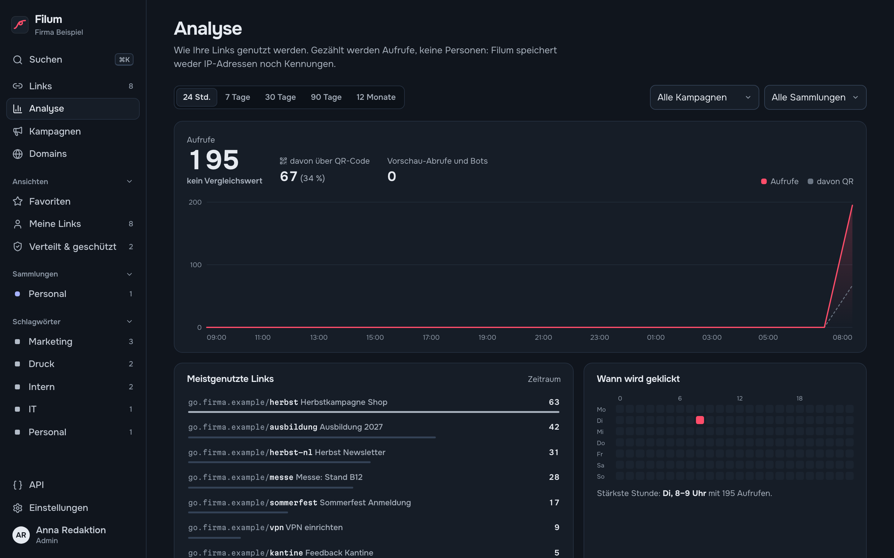

# 2 — Erste Schritte

## Anmelden

Filum öffnen Sie im Browser unter der Adresse, die Ihre IT eingerichtet hat, z. B. `https://filum.intranet.firma.de`. Melden Sie sich mit **E-Mail** und **Passwort** an, oder mit dem Knopf Ihres Firmen-Logins (z. B. *Mit authentik anmelden*), falls er angeboten wird.

**Eingeladen worden?** Öffnen Sie den Einladungslink, den Sie erhalten haben. Auf der Seite **Einladung annehmen** wählen Sie Ihren Namen und ein Passwort mit mindestens 10 Zeichen. Der Link gilt 7 Tage.

## Ganz am Anfang: Filum einrichten (Admin)

Nach der Installation zeigt Filum die Seite **Filum einrichten**. Dort tragen Sie ein:

1. **Einrichtungscode**: steht im Protokoll des Servers (`docker compose logs filum`). Er stellt sicher, dass nur, wer Zugriff auf den Server hat, das erste Konto anlegt.
2. **Ihr Name**, **E-Mail**, **Passwort** (zweimal).
3. **Konto anlegen und starten**. Dieses erste Konto ist Admin.

Danach als Admin, in dieser Reihenfolge:

1. Unter **Domains** prüfen, ob die Kurzlink-Domain aus der Installation aktiv ist; weitere hinzufügen ([Kapitel 9](09-domains.md)).
2. Unter **Einstellungen → Allgemein** Organisation und Zeitzone setzen ([Kapitel 11](11-einstellungen.md)).
3. Unter **Einstellungen → Datenschutz** die Statistikstufe wählen und den Textbaustein in die Datenschutzerklärung übernehmen ([Kapitel 12](12-datenschutz.md)).
4. Unter **Einstellungen → Team & Rollen** Kolleginnen und Kollegen einladen ([Kapitel 10](10-team-und-rechte.md)).

## Die Oberfläche

| Bereich | Inhalt |
| --- | --- |
| **Eingabefeld oben** | Lange Adresse einfügen, Enter, fertig ([Kapitel 3](03-links-anlegen.md)) |
| **Seitenleiste** | **Suchen** (`⌘K`), **Links**, **Analyse**, **Kampagnen**, **Domains**; darunter *Ansichten* (Favoriten, Meine Links, Verteilt & geschützt, Ziel gestört), *Sammlungen* und *Schlagwörter*; unten **API**, **Einstellungen** und Ihr Konto |
| **Linkliste** | Alle Links mit Aufrufen und Status ([Kapitel 4](04-links-verwalten.md)) |
| **Editor rechts** | Öffnet sich beim Klick auf einen Link |

Filum funktioniert auch auf dem Smartphone; die Seitenleiste klappt dann über das Menüsymbol auf.

**Hell oder dunkel:** Filum folgt der Einstellung Ihres Betriebssystems. Im Kontomenü (Ihr Name unten links) wählen Sie unter **Darstellung** fest *Hell*, *Dunkel* oder wieder *Wie das System*. Die Wahl gilt für diesen Browser.

## Der erste Link in 30 Sekunden

1. Kopieren Sie eine lange Adresse aus dem Browser.
2. Klicken Sie in Filum in **Lange Adresse einfügen** und fügen Sie sie ein.
3. Optional: Tippen Sie eine eigene **Kurzadresse**, z. B. `sommerfest`.
4. **Enter**. Der Kurzlink ist kopiert. Fügen Sie ihn in eine E-Mail ein und probieren Sie ihn aus.
5. Klicken Sie auf **Details**, um Titel, Schlagwörter oder einen QR-Code zu ergänzen.

## Hilfe in Filum

- Die Taste `?` zeigt alle Tastenkürzel.
- Viele Felder haben einen kurzen Hinweistext darunter.
- Fehlermeldungen sagen, was zu tun ist, etwa *„Das sieht nicht nach einer Webadresse aus. Beispiel: https://www.beispiel.de“*.

---

Weiter: [3 — Links anlegen](03-links-anlegen.md) · [Zur Übersicht](README.md)
