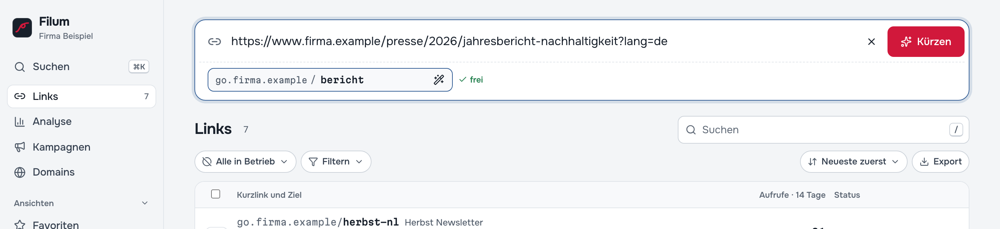
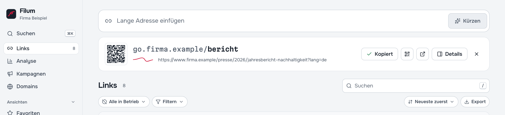

# 3 — Links anlegen

Der wichtigste Handgriff in Filum dauert zwei Sekunden: lange Adresse einfügen, **Enter**, fertig. Der Kurzlink liegt danach bereits in der Zwischenablage.

## Der schnelle Weg

1. Lange Adresse oben in das Feld **Lange Adresse einfügen** einfügen (oder Taste `N` drücken, um dorthin zu springen).
2. **Enter** drücken oder auf **Kürzen** klicken.
3. Mit **Strg/⌘ + V** dort einfügen, wo der Link hin soll.

Nach dem Kürzen erscheint eine Ergebniskarte mit einem kleinen QR-Code und den Knöpfen **Kopieren**, **QR-Code herunterladen** (PNG, 1024 px), **Kurzlink testen** und **Details**. Mit **Details** öffnen Sie den neuen Link im Editor ([Kapitel 4](04-links-verwalten.md)).

## Optionen vor dem Kürzen

Sobald etwas im Feld steht, erscheinen darunter weitere Einstellungen:

| Einstellung | Wirkung |
| --- | --- |
| **Domain** | Auf welcher Kurzlink-Domain der Link entsteht. Die Auswahl erscheint nur, wenn mehr als eine Domain aktiv ist. |
| **Kurzadresse** | Der Teil hinter dem Schrägstrich, z. B. `herbst`. Leer lassen heißt *automatisch*. Filum prüft beim Tippen und zeigt **frei** oder den Grund, warum die Adresse nicht geht. Leerzeichen werden zu Bindestrichen. |
| **Zauberstab** | *Lesbare Kurzadresse vorschlagen*: macht aus dem Ziel einen sprechenden Vorschlag, z. B. `sommerfest-anmeldung`. |
| **Vorlage** | Erscheint nur, wenn Vorlagen angelegt sind. Übernimmt in einem Schritt Weiterleitungsart, Schlagwörter, Sammlung, Kampagne, Schutz, Ablauf und Domain ([Kapitel 6](06-kampagnen-sammlungen.md#vorlagen)). |

Mit **Esc** leeren Sie das Feld.

**Welche Kurzadressen gehen?** Buchstaben, Ziffern und Bindestriche. Einige Adressen sind reserviert (etwa solche, die Filum selbst braucht), ebenso alle Kurzadressen, die schon einmal vergeben waren: Eine gelöschte Kurzadresse wird nie wieder neu vergeben, damit ein gedruckter Link nie unbemerkt woanders hinführt.

## Gibt es den Link schon?

Wenn für dasselbe Ziel bereits ein Kurzlink existiert, meldet Filum das vor dem Anlegen:

> Für dieses Ziel gibt es schon go.firma.de/herbst (63 Aufrufe). Sie können ihn wiederverwenden oder trotzdem einen neuen anlegen.

**Vorhandenen kopieren** legt den bestehenden Link in die Zwischenablage. Ein neuer Link ist trotzdem sinnvoll, wenn Sie getrennt zählen wollen, etwa einen für den Flyer und einen für den Newsletter.

## Mehrere Adressen auf einmal

Fügen Sie eine Liste ein (eine Adresse pro Zeile, oder getrennt durch Leerzeichen, Komma oder Semikolon). Filum zeigt dann *„5 Adressen erkannt. Jede bekommt eine eigene Kurzadresse …“*, und der Knopf heißt **5 kürzen**. Nach dem Klick liegen alle Kurzlinks untereinander in der Zwischenablage, z. B. zum Einfügen in eine Tabelle. Ungültige Adressen werden übersprungen und gezählt.

Für Hunderte von Links aus einer Tabelle gibt es den Import ([Kapitel 4](04-links-verwalten.md#import-und-export)).

## Direkt aus dem Browser: „Mit Filum kürzen“

Unter **Einstellungen → API & Lesezeichen** steht der Knopf **Mit Filum kürzen**. Ziehen Sie ihn mit der Maus in die Lesezeichenleiste Ihres Browsers. Ab dann gilt: Seite besuchen, auf das Lesezeichen klicken, und Filum öffnet sich in einem neuen Tab mit der Adresse dieser Seite bereits im Eingabefeld. Es wird nichts übertragen, bis Sie in Filum auf **Kürzen** klicken.

## Wenn etwas nicht klappt

| Meldung | Bedeutung |
| --- | --- |
| *Das sieht nicht nach einer Webadresse aus.* | Es fehlt meist `https://` oder ein Teil der Adresse. Beispiel: `https://www.beispiel.de` |
| *Dieser Adresstyp ist aus Sicherheitsgründen nicht erlaubt.* | Etwa `javascript:` oder `file:`. Welche Adresstypen erlaubt sind (z. B. `mailto:` oder `tel:`), legt die Administration fest ([Kapitel 11](11-einstellungen.md)). |
| *Es ist noch keine aktive Kurzlink-Domain eingerichtet* | Die Administration muss zuerst eine Domain anlegen ([Kapitel 9](09-domains.md)). |
| Kurzadresse *nicht verfügbar* | Schon vergeben, früher vergeben oder reserviert. Eine andere wählen oder leer lassen. |

---

Weiter: [4 — Links finden und bearbeiten](04-links-verwalten.md) · [Zur Übersicht](README.md)
