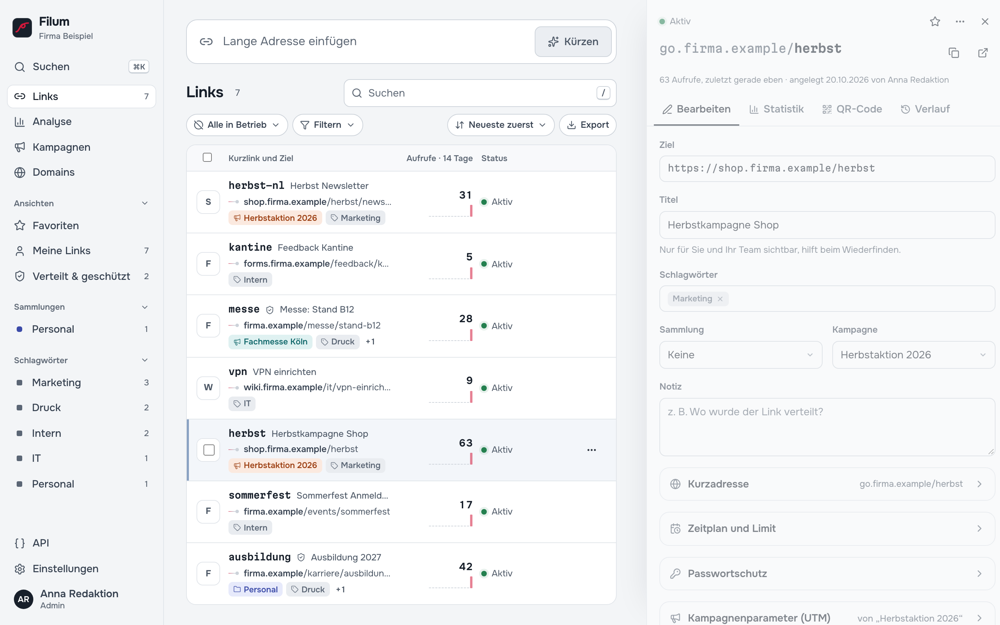

# 4 — Links finden und bearbeiten

Die Ansicht **Links** ist die Startseite von Filum. Ein Klick auf eine Zeile öffnet rechts den Editor mit allen Details des Links.

## Die Linkliste

Jede Zeile zeigt Kurzlink und Ziel, Titel, bis zu zwei Kennzeichen (Kampagne, Sammlung, Schlagwort), die **Aufrufe der letzten 14 Tage** als Zahl mit kleinem Verlauf und den **Status**:

| Status | Bedeutung |
| --- | --- |
| **Aktiv** | Leitet weiter. |
| **Geplant** | Der Zeitplan beginnt erst später ([Kapitel 5](05-zeitplan-schutz-regeln.md)). |
| **Abgelaufen** / **Limit erreicht** | Ablaufdatum oder Aufruflimit erreicht. |
| **Deaktiviert** | Von Hand abgeschaltet. |
| **Archiviert** | Leitet weiter, ist aber aus der normalen Liste ausgeblendet. |
| … **· Ziel gestört** | Die regelmäßige Zielprüfung erreicht das Ziel nicht (z. B. Seite gelöscht). Der Kurzlink selbst funktioniert, führt aber ins Leere. |

Kleine Symbole kennzeichnen Favoriten, verteilte (geschützte) Links und Links mit Passwort.

## Links wiederfinden

- **Suchen** (Taste `/`): findet Teile von Kurzadresse, Ziel, Titel, Notiz und Schlagwörtern, auch mitten im Wort.
- **Status-Auswahl**: *Alle in Betrieb* (Standard, ohne Archiv), *Aktiv*, *Geplant*, *Abgelaufen*, *Deaktiviert*, *Archiviert*, *Alles inklusive Archiv*.
- **Filtern**: Favoriten, Verteilt & geschützt, Ziel gestört, Domain, Sammlung, Kampagne, Schlagwort.
- **Sortieren**: Neueste zuerst, Zuletzt geändert, Meiste Aufrufe, Zuletzt aufgerufen, Kurzadresse A–Z, Läuft bald ab.
- **Seitenleiste**: fertige Ansichten (*Favoriten*, *Meine Links*, *Verteilt & geschützt*, *Ziel gestört*), Ihre Sammlungen und die häufigsten Schlagwörter.
- **Befehlspalette** (`⌘K` bzw. `Strg+K`): Link per Name suchen, kopieren, überall hinspringen.

## Einen Link bearbeiten

Der Editor hat vier Reiter:

| Reiter | Inhalt |
| --- | --- |
| **Bearbeiten** | Ziel, Titel, Schlagwörter, Sammlung, Kampagne, Notiz. Darunter aufklappbar: Kurzadresse, Zeitplan und Limit, Passwortschutz, Kampagnenparameter (UTM), Regeln und Varianten, Weiterleitung ([Kapitel 5](05-zeitplan-schutz-regeln.md)). |
| **Statistik** | Aufrufe dieses Links im Zeitverlauf ([Kapitel 8](08-analyse.md#statistik-eines-einzelnen-links)). |
| **QR-Code** | Code herunterladen und gestalten ([Kapitel 7](07-qr-codes.md)). |
| **Verlauf** | Jede Änderung an Ziel, Zeitplan oder Regeln mit Zeit und Person. Ein älterer Stand lässt sich mit einem Klick zurückholen. |

Wichtige Felder:

- **Ziel**: Die Änderung gilt **sofort**, auch für bereits gedruckte oder verschickte Kurzlinks. Genau dafür sind Kurzlinks da.
- **Titel**: *Nur für Sie und Ihr Team sichtbar, hilft beim Wiederfinden.* Filum bietet an, den Seitentitel des Ziels zu übernehmen.
- **Notiz**: z. B. *Wo wurde der Link verteilt?* Hilft Monate später beim Aufräumen.

Sobald Sie etwas ändern, erscheint unten die Leiste **Ungespeicherte Änderungen** mit **Verwerfen** und **Speichern** (`⌘S`). Wer den Link mit offenen Änderungen verlässt, wird gefragt.

Oben rechts im Editor: **Kurzlink kopieren**, **Kurzlink testen**, der Stern für **Favoriten** und das Menü **…** mit *Duplizieren*, *Ziel jetzt prüfen*, *Deaktivieren*, *Archivieren* und *Löschen*.

## Kurzadresse ändern

Unter **Kurzadresse** lässt sich die Adresse hinter dem Schrägstrich ändern. Hat der Link schon Aufrufe, warnt Filum: Die alte Adresse funktioniert danach nicht mehr und bleibt reserviert. Bei Links, die schon im Umlauf sind, ist es meist besser, das **Ziel** zu ändern und die Kurzadresse zu lassen.

## Verteilte Links schützen

Für alles, was gedruckt oder verschickt wurde: **Kurzadresse → Verteilt – vor Versehen schützen**. Dann

- lässt sich die Kurzadresse nicht mehr ändern,
- braucht Löschen eine ausdrückliche Bestätigung,
- werden Zieländerungen deutlich markiert (*„Dieser Link ist verteilt. Wer ihn bereits hat, landet nach dem Speichern sofort beim neuen Ziel …“*).

Die Ansicht **Verteilt & geschützt** in der Seitenleiste zeigt alle diese Links.

## Deaktivieren, archivieren, löschen

| Aktion | Was Besucher sehen | Wann sinnvoll |
| --- | --- | --- |
| **Deaktivieren** | Hinweisseite *„Dieser Link ist zurzeit nicht aktiv“*, oder das Ersatzziel, falls gesetzt | vorübergehend abschalten |
| **Archivieren** | Weiterleitung funktioniert weiter | Liste aufräumen, Link bleibt in Betrieb |
| **Löschen** | Hinweisseite *„Dieser Link wurde entfernt“* | endgültig. Die Kurzadresse bleibt reserviert und wird nie neu vergeben. |

Deaktivieren und Archivieren lassen sich jederzeit rückgängig machen (*Reaktivieren*, *Aus Archiv holen*).

## Mehrere Links auf einmal

Klicken Sie links in der Zeile auf das Symbol (oder Taste `X`), um Links auszuwählen; mit gedrückter Umschalttaste wählen Sie einen ganzen Bereich. Unten erscheint die Leiste **… ausgewählt** mit:

Export als CSV · Schlagwort hinzufügen · Sammlung · Kampagne · Domain (nur bei mehreren Domains, mit Bestätigung, siehe [Kapitel 9](09-domains.md#links-auf-eine-andere-domain-verschieben)) · Deaktivieren/Aktivieren · **Mehr** (Favorit, *Als verteilt schützen*, *Schutz aufheben*, Archivieren, Aus Archiv holen) · Löschen.

Löschen ist zweistufig und nennt ausdrücklich, wie viele der ausgewählten Links geschützt sind.

## Import und Export

**Export** (Knopf oben rechts in der Liste) exportiert die *aktuelle Ansicht*, also mit allen gesetzten Filtern:

- **CSV für Excel und LibreOffice**
- **JSON mit allen Feldern** (auch für den Umzug in eine andere Filum-Installation)

**Import** unter **Einstellungen → Import**: CSV-Datei hochladen oder Inhalt einfügen. Filum erkennt die Spalten an deutschen oder englischen Namen, etwa `url`/`ziel`, `slug`/`kurzadresse`, `title`/`titel`, `tags`/`schlagwörter`, `notiz`, `ablauf`, `ersatzziel`, `aufruflimit`. Für alle importierten Links lassen sich Domain, Sammlung, Kampagne und zusätzliche Schlagwörter festlegen, außerdem, was bei einer schon vergebenen Kurzadresse passiert:

- *Zeile überspringen*
- *Mit neuer, zufälliger Kurzadresse anlegen*
- *Vorhandenen Link aktualisieren*

Der Import läuft in zwei Schritten: **Prüfen** zeigt, was passieren würde, erst **… Links importieren** legt an.

## Tastenkürzel

Die Taste `?` zeigt die Übersicht jederzeit in Filum.

| Taste | Wirkung |
| --- | --- |
| `N` | Neuen Kurzlink anlegen (Eingabefeld) |
| `/` | Links durchsuchen; `↓` springt aus der Suche in die Liste |
| `⌘K` / `Strg+K` | Befehlspalette |
| `J` / `K` oder `↓` / `↑` | In der Liste nach unten/oben |
| `Enter` | Markierten Link öffnen |
| `C` | Kurzlink der markierten Zeile kopieren |
| `X` / `Umschalt+X` | Zeile / Bereich auswählen |
| `Esc` | Eingabe leeren, Dialog oder Editor schließen |
| `⌘S` / `Strg+S` | Änderungen speichern |
| `G`, dann `L` / `A` / `K` / `D` / `E` | Links, Analyse, Kampagnen, Domains, Einstellungen |

---

Weiter: [5 — Zeitplan, Schutz und Regeln](05-zeitplan-schutz-regeln.md) · [Zur Übersicht](README.md)
