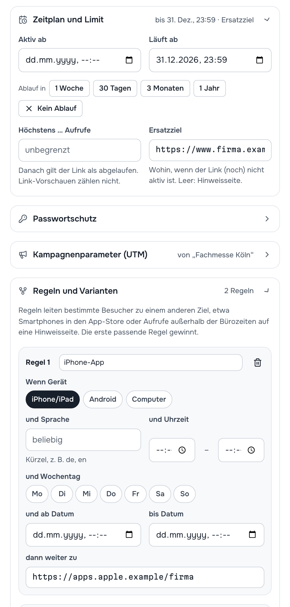
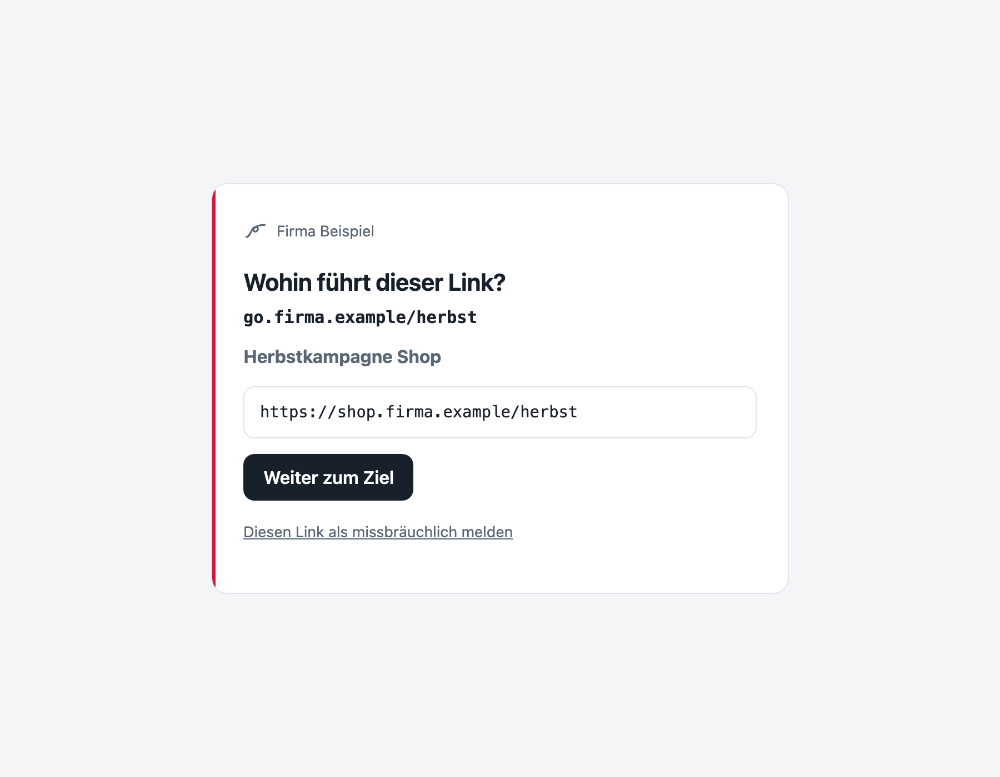

# 5 — Zeitplan, Schutz und Regeln

Im Editor eines Links ([Kapitel 4](04-links-verwalten.md)) stehen unter den Grundfeldern aufklappbare Abschnitte. Sie machen aus einem einfachen Kurzlink einen, der zur richtigen Zeit das Richtige tut.

## Zeitplan und Limit

| Feld | Wirkung |
| --- | --- |
| **Aktiv ab** | Vorher sehen Besucher *„Dieser Link ist noch nicht freigeschaltet – Er wird am … aktiv.“* |
| **Läuft ab** | Danach: *„Dieser Link ist abgelaufen“*. Schnellwahl: in 1 Woche, 30 Tagen, 3 Monaten, 1 Jahr, oder *Kein Ablauf*. |
| **Höchstens … Aufrufe** | Danach gilt der Link als abgelaufen. Link-Vorschauen von Messengern zählen nicht mit. Leer heißt unbegrenzt. |
| **Ersatzziel** | Wohin Besucher kommen, wenn der Link (noch) nicht aktiv ist, statt einer Hinweisseite. Gilt für *geplant*, *abgelaufen* und *deaktiviert*. |

Beispiel: Ein Gewinnspiel-Link mit **Läuft ab** am Aktionsende und **Ersatzziel** auf die Seite „Danke fürs Mitmachen“. Nach Ende landet niemand auf einer Fehlerseite.

## Passwortschutz

Ein Passwort (mindestens 8 Zeichen) schützt das Ziel. Besucher sehen zuerst die Seite *„Dieser Link ist geschützt – Bitte geben Sie das Passwort ein, das Sie zusammen mit dem Link erhalten haben.“* Erst nach richtiger Eingabe geht es weiter.

- Nach mehreren Fehlversuchen sperrt Filum kurzzeitig, auch für das richtige Passwort. So lässt sich das Passwort nicht durchprobieren.
- Das Passwort wird nur als Prüfwert gespeichert. Auch Admins können es nicht nachlesen, nur ändern oder entfernen.
- Die Vorschau mit `+` ([unten](#vorschau-für-empfänger)) verrät das Ziel geschützter Links nicht.

## Kampagnenparameter (UTM)

Felder **Quelle**, **Medium**, **Kampagne**, **Begriff**, **Inhalt**. Filum hängt sie beim Aufruf als `utm_source`, `utm_medium` usw. an das Ziel an; Ihre Webanalyse sieht dann, woher Besucher kamen. Die Zeile **Besucher landen auf** zeigt die fertige Adresse.

Gehört der Link zu einer Kampagne, kommen deren Werte automatisch dazu ([Kapitel 6](06-kampagnen-sammlungen.md)). Was Sie hier eintragen, überschreibt die Kampagnenwerte nur für diesen Link.

## Regeln und Varianten

**Regeln** leiten je nach Situation auf ein anderes Ziel. Jede Regel kann diese Bedingungen haben; sind mehrere gesetzt, müssen alle zutreffen:

| Bedingung | Möglichkeiten |
| --- | --- |
| **Wenn Gerät** | iPhone/iPad, Android, Computer |
| **und Sprache** | Sprachkürzel des Browsers, z. B. `en`, `fr` |
| **und Uhrzeit** | von … bis … (Zeitzone aus den Einstellungen) |
| **und Wochentag** | Mo bis So |
| **und ab Datum / bis Datum** | Zeitraum |

… **dann weiter zu**: dem Ziel der Regel. *Die erste passende Regel gewinnt*; passt keine, gilt das normale Ziel.

Beispiele:

- *Wenn Gerät iPhone/iPad, dann App-Store-Adresse*, *wenn Android, dann Play Store*. Ein QR-Code für beide Welten.
- *Wenn Uhrzeit 18–8 Uhr, dann Seite „Notdienst“*.
- *Wenn Sprache `en`, dann englische Seite*.

**Varianten** verteilen Besucher zufällig nach Gewicht auf bis zu fünf Ziele, z. B. für einen A/B-Vergleich zweier Landingpages. Die Statistik des Links zeigt unter **Gewählte Ziele**, wie oft welche Variante gewählt wurde.

## Weiterleitung

| Art | Wann |
| --- | --- |
| **Temporär (302) – empfohlen** | Standard. Browser fragen bei jedem Aufruf neu nach; Zieländerungen wirken sofort. |
| **Permanent (301)** | Für Links, deren Ziel sich nie ändert. Browser merken sich das Ziel begrenzt (Standard 60 Minuten), damit eine spätere Änderung trotzdem ankommt. |
| **307 / 308** (unter *Weitere Arten*) | Wie 302/301, aber die Anfragemethode bleibt erhalten. Nur für technische Sonderfälle. |

Hat der Link Zeitplan, Limit, Passwort oder Regeln, sendet Filum automatisch eine temporäre Weiterleitung, sonst würde ein Browser ein veraltetes Ziel festhalten.

**Parameter weitergeben**: Hängt jemand selbst etwas an den Kurzlink (`go.firma.de/herbst?ref=mail`), landet `?ref=mail` auch am Ziel.

## Vorschau für Empfänger

Hängt man an einen Kurzlink ein **+** an, also `go.firma.de/herbst+`, leitet Filum nicht weiter, sondern zeigt die Seite *„Wohin führt dieser Link?“* mit Ziel, Titel und dem Knopf **Weiter zum Ziel**. Empfänger können so vor dem Klick prüfen, wohin sie geführt werden, und über *„Diesen Link als missbräuchlich melden“* einen Hinweis an die Administration geben ([Kapitel 11](11-einstellungen.md#sicherheit)).

Die Vorschau lässt sich je Domain abschalten ([Kapitel 9](09-domains.md)).

## Was Besucher sonst sehen

| Situation | Seite |
| --- | --- |
| Deaktiviert | *Dieser Link ist zurzeit nicht aktiv* |
| Noch nicht aktiv | *Dieser Link ist noch nicht freigeschaltet* (mit Datum) |
| Abgelaufen oder Limit erreicht | *Dieser Link ist abgelaufen* |
| Gelöscht | *Dieser Link wurde entfernt* |
| Unbekannte Kurzadresse | *Link nicht gefunden – Bitte prüfen Sie die Schreibweise.* Auf internen Domains mit Vorschlag *„Meinten Sie …?“* |

Ein **Ersatzziel** ersetzt die ersten drei Seiten. Für unbekannte Kurzadressen kann je Domain eine eigene Zielseite festgelegt werden.

---

Weiter: [6 — Kampagnen, Sammlungen und Vorlagen](06-kampagnen-sammlungen.md) · [Zur Übersicht](README.md)
