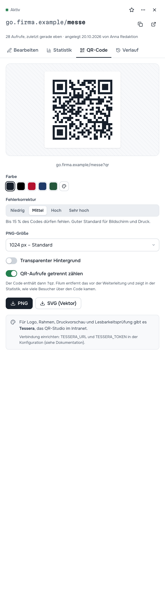

# 7 — QR-Codes

Jeder Kurzlink hat einen QR-Code, im Editor unter dem Reiter **QR-Code**. Weil der Code auf den *Kurzlink* zeigt und nicht auf das Ziel, bleibt ein gedruckter Code gültig, auch wenn Sie das Ziel später ändern.



## Code herunterladen

| Einstellung | Möglichkeiten |
| --- | --- |
| **Farbe** | Tinte, Schwarz, Karmin, Marine, Tanne oder *Eigene Farbe*. Dunkle Farben auf hellem Grund lesen Kameras am zuverlässigsten. |
| **Fehlerkorrektur** | Niedrig (7 %), **Mittel (15 %, Standard)**, Hoch (25 %), Sehr hoch (30 %). Höher heißt: Der Code bleibt lesbar, auch wenn ein Teil verdeckt oder verschmutzt ist, wird aber dichter. Für Plakate im Freien *Hoch*. |
| **PNG-Größe** | 512 px (Bildschirm), 1024 px (Standard), 2048 px (Druck), 4096 px (Plakat) |
| **Transparenter Hintergrund** | für farbige Untergründe |
| **QR-Aufrufe getrennt zählen** | standardmäßig an, siehe unten |

**PNG** für Office-Dokumente und Webseiten, **SVG (Vektor)** für die Druckerei: SVG lässt sich ohne Qualitätsverlust beliebig vergrößern.

Schneller geht es direkt nach dem Anlegen: Die Ergebniskarte hat den Knopf **QR-Code herunterladen** (PNG, 1024 px).

## Wie viele kamen über den QR-Code?

Mit **QR-Aufrufe getrennt zählen** enthält der Code den Kurzlink mit angehängtem `?qr`, etwa `go.firma.de/messe?qr`. Filum entfernt diesen Zusatz vor der Weiterleitung (das Ziel sieht ihn nie) und weist solche Aufrufe in der Statistik als **über QR-Code** aus. So sehen Sie, ob das Plakat oder der Newsletter mehr gebracht hat, mit nur einem Link.

## Gestaltete Codes mit Tessera

Für Codes mit Logo, Rahmen, Druckvorschau, Schnittmarken und Lesbarkeitsprüfung gibt es im Intranet **Tessera**. Ist Tessera angebunden, steht im QR-Reiter **In Tessera gestalten**: Filum legt dort einen Code mit dem Kurzlink (inklusive `?qr`) an, Schlagwort „Filum“, und öffnet ihn im Tessera-Editor.

Ohne Anbindung erscheint der Hinweis *„Tessera ist noch nicht mit Filum verbunden“*. Alles andere funktioniert unabhängig davon.

## Für die IT: Tessera anbinden

1. In Tessera unter **Optionen → Schnittstelle** ein Token für ein Konto mit der Rolle **Bearbeiten** erstellen.
2. In Filums `.env`:
   ```ini
   TESSERA_URL=https://qr.intranet.firma.de
   TESSERA_TOKEN=tsr_…
   ```
3. `docker compose up -d`.

Filum legt den Code über `POST /api/codes` an (statischer URL-Code) und öffnet `/codes/<id>` im Tessera-Editor. Die Verbindung geht vom Filum-Server zu Tessera, nicht vom Browser; das Token verlässt den Server nie. Ist Tessera nicht erreichbar, meldet Filum das verständlich, und alle anderen Funktionen laufen weiter.

Umgesetzt nach der dokumentierten Tessera-Schnittstelle. Automatisch getestet ist der Aufruf gegen einen nachgebauten Tessera-Endpunkt (Anfrageform, Token, Fehlerfälle); ein Test gegen eine laufende Tessera-Instanz steht aus ([Kapitel 23](23-einschraenkungen.md)).

---

Weiter: [8 — Analyse](08-analyse.md) · [Zur Übersicht](README.md)
