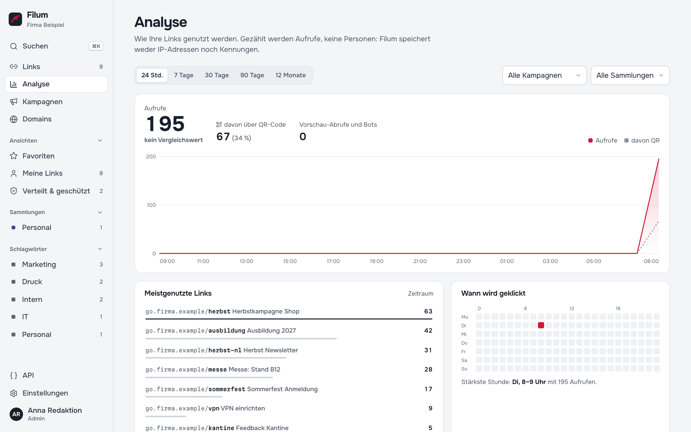
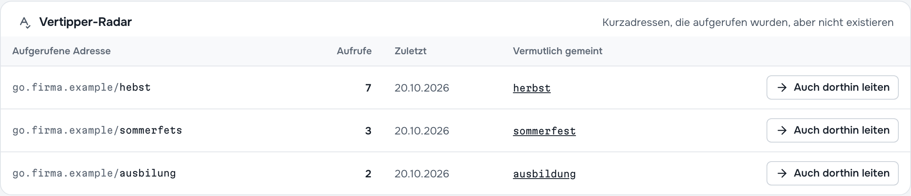

# 8 — Analyse

*Wie Ihre Links genutzt werden. Gezählt werden Aufrufe, keine Personen: Filum speichert weder IP-Adressen noch Kennungen.* So steht es über der Ansicht **Analyse**, und so ist es gebaut ([Kapitel 12](12-datenschutz.md)).

## Die Übersicht

Oben wählen Sie den **Zeitraum** (24 Std., 7 Tage, 30 Tage, 90 Tage, 12 Monate) und schränken bei Bedarf auf eine **Kampagne**, **Sammlung** oder **Domain** ein.

| Bereich | Was er zeigt |
| --- | --- |
| **Aufrufe** | Summe im Zeitraum mit Vergleich zum gleich langen Zeitraum davor (*+12 % gegenüber dem Zeitraum davor*) |
| **davon über QR-Code** | Anteil der Aufrufe über Codes mit `?qr` ([Kapitel 7](07-qr-codes.md#wie-viele-kamen-über-den-qr-code)) |
| **Vorschau-Abrufe und Bots** | Link-Vorschauen in Messengern, Suchmaschinen und andere automatische Abrufe. Sie werden getrennt gezählt und verfälschen die Aufrufe nicht. |
| **Diagramm** | Verlauf der Aufrufe und des QR-Anteils |
| **Meistgenutzte Links** | Rangliste; ein Klick öffnet den Link |
| **Wann wird geklickt** | Wochentag × Uhrzeit als Wärmebild, mit der stärksten Stunde. Gut, um Versandzeitpunkte zu planen. |
| **Kampagnen im Vergleich** | Aufrufe je Kampagne; ein Klick filtert die Analyse auf diese Kampagne |
| **Was mit Aufrufen passiert** | Weitergeleitet, Unbekannte Kurzadresse, Gelöschter Link, Deaktivierter Link, Abgelaufen oder Limit, Noch nicht aktiv, Passwortseite gezeigt, Falsches Passwort, Vorschau angesehen, Unbekannte Domain |

Ist die **erweiterte Statistik** eingeschaltet ([Kapitel 11](11-einstellungen.md#datenschutz)), kommen **Herkunft**, **Gerät**, **Betriebssystem**, **Browser** und **Sprache** hinzu, jeweils als Tagessummen. Ist die Statistik ganz aus, funktionieren Weiterleitungen unverändert; es wird nur nichts gezählt.

## Vertipper-Radar

Unten in der Analyse: *Kurzadressen, die aufgerufen wurden, aber nicht existieren*. Typische Ursachen sind ein Tippfehler auf einem Flyer, ein abgeschnittener Link in einer E-Mail oder ein falsch abgetippter Code von einem Plakat.

Die Tabelle zeigt die aufgerufene Adresse, wie oft und wann zuletzt, und unter **Vermutlich gemeint** einen vorhandenen Link mit ähnlicher Schreibweise. **Auch dorthin leiten** legt nach Rückfrage eine Kopie des gemeinten Links unter der falschen Schreibweise an, mit dem Titel *„… (Tippfehler-Variante)“* und dem Schlagwort *Tippfehler*. Ab sofort kommen auch die Vertipper ans Ziel. Gleich danach lässt sich das mit **Rückgängig** zurücknehmen.

Ohne passenden Vorschlag bietet Filum **Link anlegen** an.

## Statistik eines einzelnen Links

Im Editor eines Links, Reiter **Statistik**: dieselben Zeiträume, Aufrufe mit Vergleichswert, Anteil **Über QR-Code**, Vorschau-Abrufe und Bots sowie **Wann wird geklickt**. Bei Links mit Regeln oder Varianten zeigt **Gewählte Ziele**, wie oft welches Ziel gewählt wurde ([Kapitel 5](05-zeitplan-schutz-regeln.md#regeln-und-varianten)).

**Statistik dieses Links löschen** setzt die Zählung für diesen Link zurück, z. B. nach Testaufrufen.

## Wie gezählt wird

- **Aufruf** = eine Weiterleitung an einen Menschen. Wer einen Link dreimal öffnet, zählt dreimal; Filum kann und will Personen nicht wiedererkennen.
- **Bots und Vorschauen** erkennt Filum an der Kennung des abrufenden Programms (Messenger, Suchmaschinen, Werkzeuge wie `curl`). Sie fließen nicht in die Aufrufe ein.
- **Zeitzone**: Tage und Stunden richten sich nach der Zeitzone in den Einstellungen.
- **Verzögerung**: Aufrufe erscheinen nach wenigen Sekunden.

---

Weiter: [9 — Domains](09-domains.md) · [Zur Übersicht](README.md)
