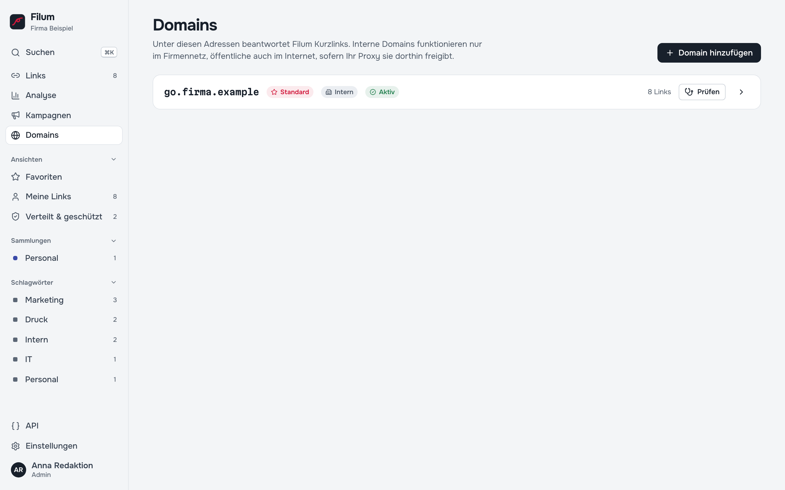

# 9 — Domains (Administration)

> Dieses Kapitel richtet sich an Admins: Nur sie legen Domains an und ändern sie.

Eine Kurzlink-Domain ist der Hostname vor der Kurzadresse, z. B. `go.firma.de` in `https://go.firma.de/herbst`. Filum verwaltet beliebig viele Domains. Jeder Link gehört genau einer Domain an; dieselbe Kurzadresse kann auf verschiedenen Domains verschiedene Ziele haben.

## Eine Domain hinzufügen

1. **Domains → Domain hinzufügen**.
2. **Hostname** eintragen: nur der Name, ohne `https://` und ohne Pfad, z. B. `go.firma.de`. Nicht die Adresse der Verwaltung.
3. **Intern** oder **Öffentlich** wählen (siehe unten) und **Hinzufügen**.
4. Unter **Proxy & DNS** stehen der passende DNS-Eintrag und fertige Bausteine für Caddy, nginx und Traefik zum Kopieren. Die IT trägt sie ein ([Kapitel 14](14-reverse-proxy.md)).
5. Öffentliche Domains: Besitz nachweisen (siehe unten). Interne Domains sind sofort aktiv.
6. **Prüfen** führt eine Diagnose durch: *Namensauflösung*, *HTTPS über den Reverse Proxy* (bzw. *HTTP*), *Berechtigung*. Jeder Schritt erscheint mit *In Ordnung*, *Hinweis*, *Fehler* oder *Übersprungen* und einer Erklärung, z. B. *„… lässt sich von diesem Server aus nicht auflösen. Fehlt der DNS-Eintrag?“*

Der Status jeder Domain steht auf ihrer Karte: **Standard**, **Aktiv**, **Nachweis fehlt** oder **Deaktiviert**.

## Intern oder öffentlich

| | Intern | Öffentlich |
| --- | --- | --- |
| Gedacht für | Links im Firmennetz (Wiki, Formulare, Laufwerke, interne Tools) | Briefe, Flyer, E-Mails an Externe, Social Media |
| Aktivierung | Admin bestätigt direkt | Erst nach technischem Nachweis (DNS oder HTTP) |
| Erreichbarkeit | Nur so weit, wie DNS und Proxy sie im Intranet freigeben | Wie vom Proxy ins Internet freigegeben |
| Missbrauch melden | – | Besucher können über `/<slug>+` melden |

Die Markierung ändert nichts an der Netzwerk-Erreichbarkeit. Die bestimmen allein DNS und Ihr Proxy. Filum warnt in der Diagnose, wenn eine als öffentlich markierte Domain auf interne Adressen auflöst.

## Besitz nachweisen

Damit niemand eine fremde Domain einträgt und darüber Weiterleitungen ausliefert, beantwortet Filum öffentliche Domains erst nach einem Nachweis. Nur Admins legen Domains an.

- **DNS-Eintrag:** TXT-Eintrag `_filum-challenge.<domain>` mit dem in Filum angezeigten Wert (`filum-verify=…`). Danach **DNS-Eintrag prüfen**.
- **HTTP-Prüfung:** Filum ruft `https://<domain>/.well-known/filum-verify` auf. Die Antwort enthält eine zufällige Kennung dieser Installation. Stimmt sie, kommt die Domain nachweislich bei dieser Filum-Instanz an.
- **Admin-Freigabe:** nur für interne Domains.

Die HTTP-Prüfung ist der einzige serverseitige Abruf, der interne Adressen erreichen darf, und zwar ausschließlich den Hostnamen der Domain selbst, nur durch Admins, ohne Weiterleitungen und nur mit Ja/Nein als Ergebnis.

## Einstellungen je Domain

| Einstellung | Wirkung |
| --- | --- |
| Standard | Neue Links landen hier, wenn nichts anderes gewählt ist. |
| HTTPS | Ob erzeugte Kurzlinks mit `https://` oder `http://` beginnen. |
| Startseite | Ziel für den Aufruf der Domain ohne Kurzadresse. Leer: neutrale Hinweisseite. |
| Unbekannte Kurzadresse | Ziel für nicht existierende Kurzadressen. Leer (empfohlen): Seite „Link nicht gefunden“ mit Status 404. |
| Länge automatischer Kurzadressen | 4–16 Zeichen. 6 Zeichen aus 31 Zeichen ergeben rund 887 Millionen Möglichkeiten. |
| Browser-Cache für permanente Links | Wie lange Browser ein 301/308-Ziel merken dürfen (Standard 60 Minuten). |
| Vorschau mit „+“ | `/<slug>+` zeigt das Ziel, ohne weiterzuleiten. |
| Deaktivieren | Die Domain beantwortet keine Kurzlinks mehr; die Links bleiben erhalten. |

Eine Domain lässt sich nur entfernen, wenn keine Links mehr auf ihr liegen.

## Links auf eine andere Domain verschieben

In der Linkliste die Links auswählen, in der Leiste **Domain** und die neue Domain wählen, dann **… nach go.neu.de verschieben** bestätigen ([Kapitel 4](04-links-verwalten.md#mehrere-links-auf-einmal)). Dabei ändert sich der Kurzlink: Die alte Adresse leitet danach nicht mehr weiter und bleibt reserviert. Als *verteilt* geschützte Links werden in der Bestätigung eigens gezählt. Für einen Domainwechsel gedruckter Links ist es meist besser, die alte Domain aktiv zu lassen.

## Was Filum nicht selbst macht

- **DNS:** Einträge setzt Ihre DNS-Verwaltung.
- **Zertifikate:** stellt der Reverse Proxy aus.
- **Proxy-Konfiguration:** Filum zeigt unter **Domains → Proxy & DNS** fertige Bausteine für Caddy, nginx und Traefik, ändert aber nichts am Proxy.

---

Weiter: [10 — Team und Rechte](10-team-und-rechte.md) · [Zur Übersicht](README.md)
