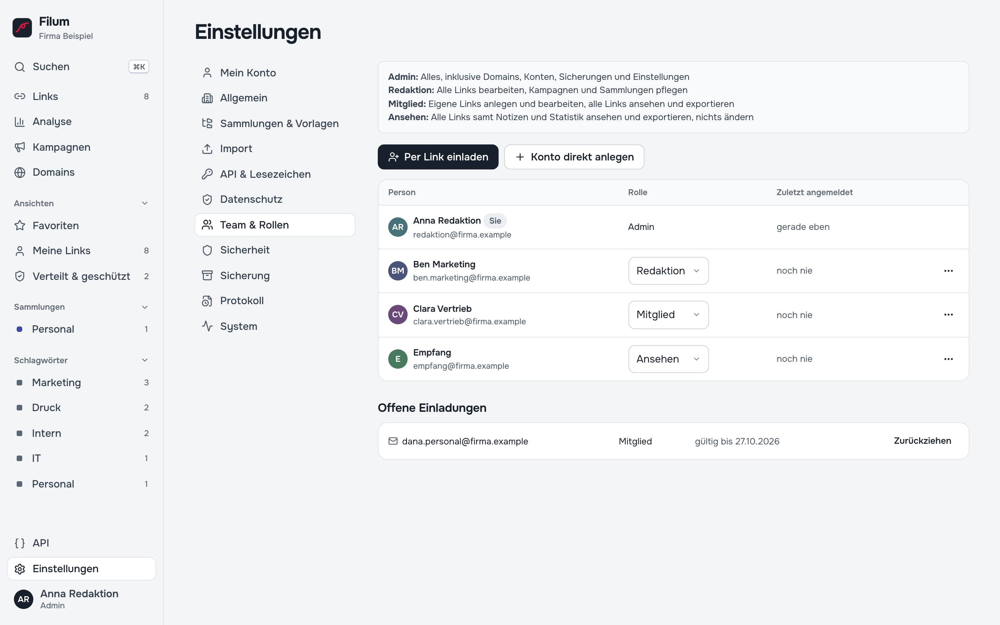

# 10 — Team und Rechte (Administration)

Filum ist für Teams gebaut: Jede Person hat ein eigenes Konto mit einer Rolle. Wer was geändert hat, steht im Verlauf jedes Links und im Protokoll.

## Die vier Rollen

| Rolle | Darf |
| --- | --- |
| **Ansehen** | Alle Links samt Notizen und Statistik ansehen und exportieren, nichts ändern |
| **Mitglied** | Eigene Links anlegen und bearbeiten, alle Links ansehen und exportieren, Vorlagen anlegen |
| **Redaktion** | Alle Links bearbeiten, Kampagnen, Sammlungen und Schlagwörter pflegen, Missbrauchsmeldungen bearbeiten |
| **Admin** | Alles, inklusive Domains, Konten, Sicherungen und Einstellungen |

Die Rechte prüft der Server bei jeder Anfrage, nicht nur die Oberfläche. Ein Mitglied kann also auch über die API keine fremden Links ändern.

## Personen hinzufügen

Unter **Einstellungen → Team & Rollen** (ab *Redaktion* sichtbar, ändern dürfen Admins):

- **Per Link einladen**: Filum erzeugt einen **Einladungslink** mit der gewählten Rolle. Sie schicken ihn selbst per E-Mail oder Chat; Filum versendet keine E-Mails. Der Link gilt 7 Tage und nur einmal. Die eingeladene Person wählt Name und Passwort selbst. Offene Einladungen lassen sich **zurückziehen**.
- **Konto direkt anlegen**: mit Name, E-Mail, Rolle und **Anfangspasswort**, z. B. für Funktionskonten.
- **Anmeldung über authentik (OIDC)**: Konten entstehen bei der ersten Anmeldung automatisch, die Rolle folgt der Gruppe im Identitätsanbieter ([Kapitel 16](16-anmeldung-oidc.md)).

Im Menü jeder Zeile: **Passwort setzen …**, **Sperren** / **Entsperren**, **Konto löschen …**. Die Links eines gelöschten Kontos gehen an den Admin über, der löscht; nichts geht verloren.

## Passwörter und Sitzungen

- Passwörter haben mindestens 10 Zeichen. Offensichtliche Muster wie `0123456789`, `passwort…` oder `qwertz…` lehnt Filum ab.
- Eine Anmeldung gilt 14 Tage und verlängert sich bei Nutzung.
- Unter **Einstellungen → Mein Konto** ändert jede Person ihr Passwort und kann sich mit **Überall sonst abmelden** auf allen anderen Geräten abmelden.
- **Passwort vergessen?** Eine Selbstbedienung per E-Mail gibt es nicht. Ein Admin setzt über **Passwort setzen …** ein neues. Hat der einzige Admin sein Passwort vergessen: [Kapitel 17](17-sicherung.md#notfall-passwort-vergessen).
- Nach mehreren falschen Anmeldeversuchen sperrt Filum kurzzeitig.

## API-Tokens

Für Skripte und andere Programme gibt es Tokens unter **Einstellungen → API & Lesezeichen**:

| Feld | Möglichkeiten |
| --- | --- |
| **Bezeichnung** | wofür, z. B. „Newsletter-System“ |
| **Rechte** | *Nur lesen*, *Lesen und schreiben* (ab Mitglied), *Admin (inkl. Domains, Konten)* (nur Admin) |
| **Gültig (Tage)** | vorbelegt 365, leer heißt unbegrenzt |

Ein Token handelt nie mit mehr Rechten als die Person, die es angelegt hat. Es wird **nur einmal angezeigt**: sofort sicher ablegen und mit **Habe ich sicher abgelegt** bestätigen. **Widerrufen** macht es sofort ungültig. Admins sehen mit **Tokens aller Konten zeigen** alle Tokens. Wie die API benutzt wird: [Kapitel 19](19-rest-api.md).

## Protokoll

Unter **Einstellungen → Protokoll** (nur Admin) steht, wer wann was getan hat: Links, Konten und Anmeldungen, Einladungen, API-Tokens, Domains, Einstellungen, Sicherungen. Filterbar nach Art; Einträge werden nach zwei Jahren gelöscht.

---

Weiter: [11 — Einstellungen](11-einstellungen.md) · [Zur Übersicht](README.md)
